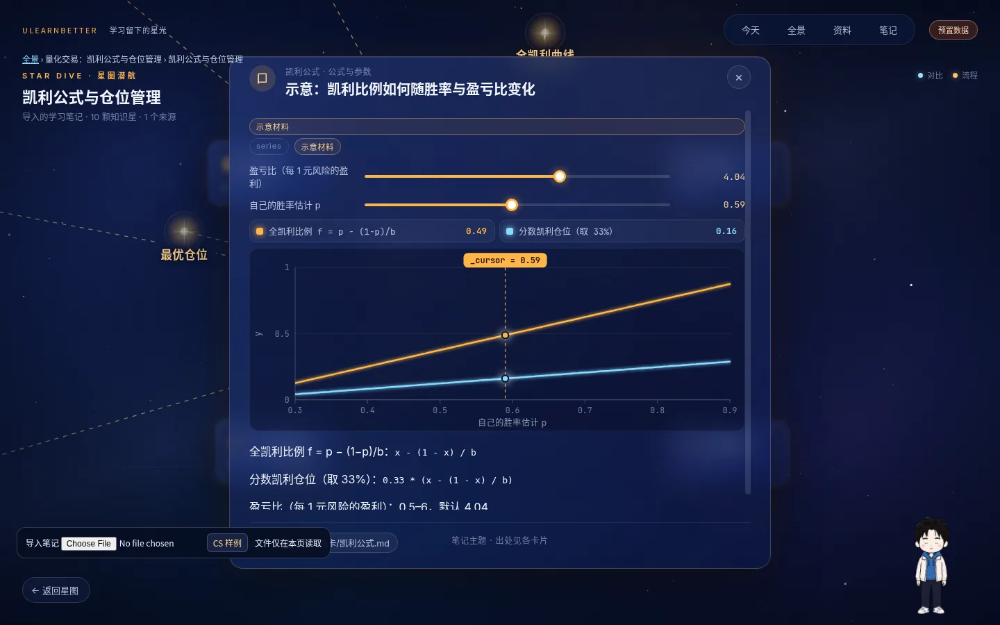
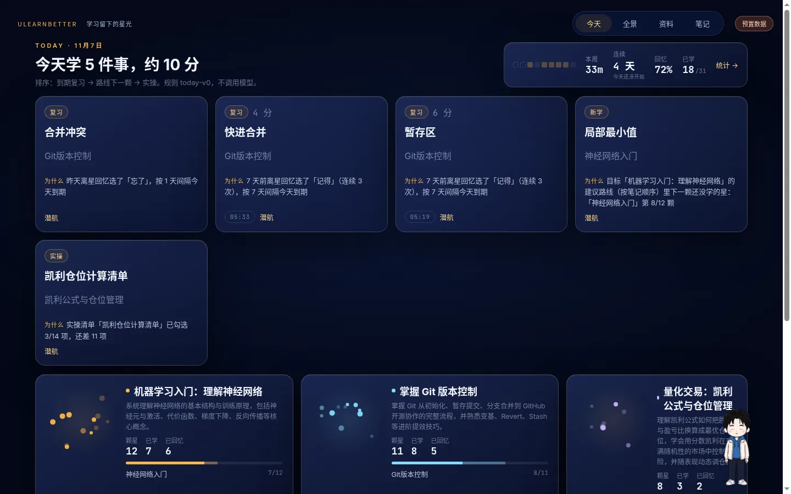
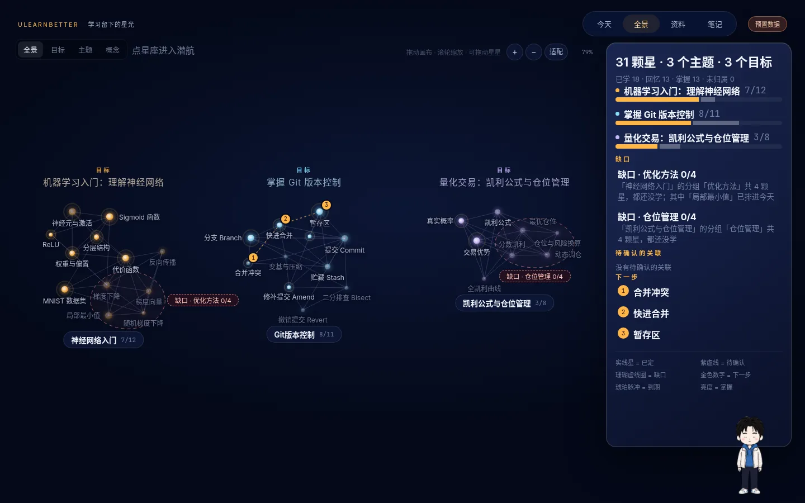
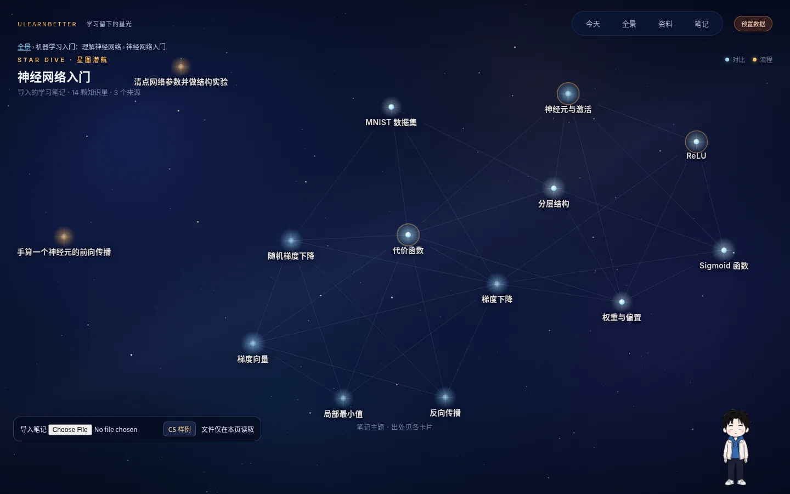
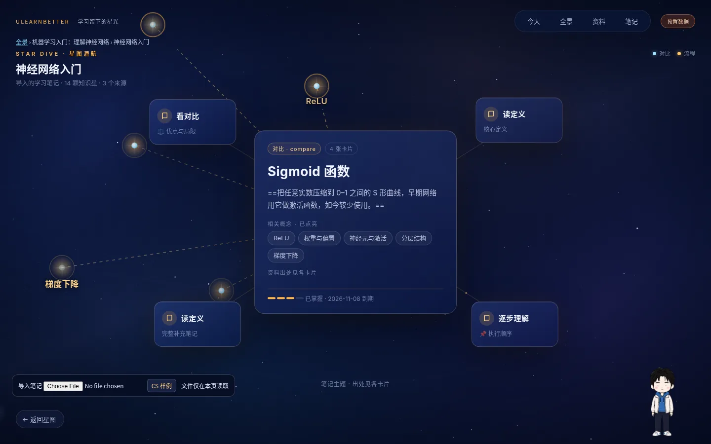
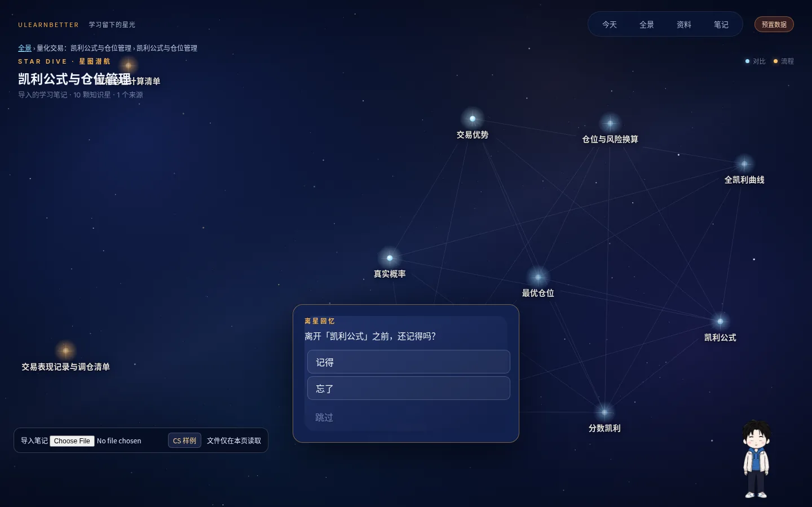
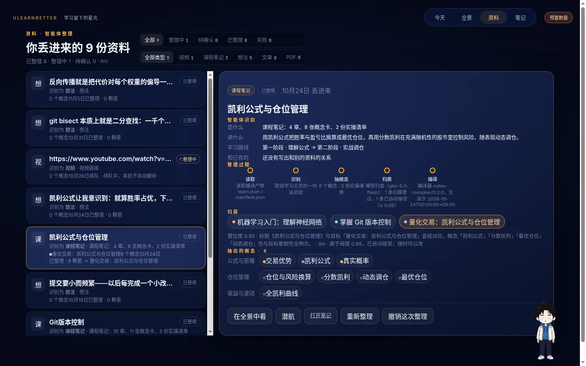
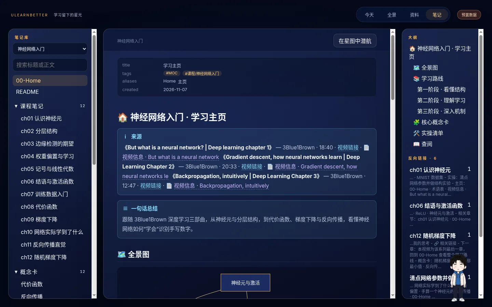

# UlearnBetter · 学习留下的星光

[](https://github.com/UworthBetter/UlearnBetter/actions/workflows/checks.yml)

> **别让收藏夹替你学习。**
> 刷到有用的视频，点个收藏，“以后再学”，然后它就和几十条别的收藏混在一起吃灰。
> UlearnBetter 补上「收藏」和「学会」之间缺的那一步：把链接丢给桌宠小原，
> 它在后台读完、拆成概念、归进你的学习目标，变成一片可以“走进去学”的星图；
> 每天打开，它告诉你今天该学哪 5 件事，以及**为什么**。



<sub>上图是应用实拍：在「凯利公式」这颗星上打开“公式与参数”卡，拖动滑块，全凯利和分数凯利两条曲线实时重算。卡片内容由模型从 Financial Wisdom 的视频生成，公式由应用实际计算，没有写死。</sub>

---

## 30 秒看懂

| | |
| --- | --- |
| **为谁做** | 靠 B 站 / YouTube 视频自学、同时推进好几条学习线的大学生和自学者（课业 + 量化 + AI 前沿）。我们自己就是第一批用户 |
| **解决什么** | **收藏不等于学会。** 每天都会撞见有用的视频，收藏、稍后再看、“以后再学”，越存越多，什么都想学，最后全混成一团，一条都没回头看。看了的，两周后也忘了 |
| **问题出在哪** | 不在你，在「看到」和「学会」中间少了一步：**太杂，理不清**；**没人提醒**；**看不见进步** |
| **怎么补上** | **理不清** → 只有一个入口：丢给小原，后台自动识别、拆成概念、归到你的学习目标（资料 · 全景）<br>**学不进** → 每个概念是一颗星，按知识形状生成能拖、能步进、能对照的卡片，出处回到原视频那一秒（星图潜航 · 笔记）<br>**没人提醒** → 每天最多 5 件事，到期复习排在前面，每条都写明为什么（今天）<br>**看不见进步** → 离开一颗星时点一下「记得 / 忘了」，学会的星会变亮，没碰过的地方圈成缺口（全景） |
| **和收藏夹、笔记工具的区别** | 收藏夹管“存下来”，笔记工具管“记下来”，UlearnBetter 管“学进去”：存进来的每一条都会被整理成能学的星，并且有人告诉你什么时候该回来 |
| **能不能跑** | 一条命令启动完整演示：3 个学习目标、31 颗知识星。笔记、星图和归类由真实流水线和真实模型从 6 个公开视频生成，另附 17 天学习记录（脚本模拟，经真实接口写入）。261 个自动化测试，CI 三条流水线全绿 |

👉 **评委导读（按评分维度列出证据和文件位置）：[docs/pitch/README.md](docs/pitch/README.md)**

---

## 一条命令启动

```bash
# 首次安装（Node ≥ 20）
cd server && npm ci && cd ../concept-graph && npm ci && cd ..

# 启动预置演示：后端 + 前端 + 数据，一步完成
cd server && npm run demo
# 打开 http://localhost:5173/#/today
```

- **不需要任何 API Key** 就能完整体验今天、全景、星图潜航、资料和笔记五个视图。学习记录、掌握度、今日计划、统计全部由确定性规则在本地算出，不调用模型，也不花一分钱。
- 想体验 AI 助手和“贴链接自动生成星图”，打开 `http://127.0.0.1:4000/settings`，选一家模型并填入密钥，保存后立即生效，不用重启。支持 Anthropic、OpenAI、Google、Groq 和任意 OpenAI 兼容端点（如 DeepSeek、智谱）。贴链接生成星图还需要本机有 Python 3 和 yt-dlp（见[下文](#换一个输入也能跑)）。
- 每次启动，演示数据的日期都会自动平移到“昨天”，所以任何一天打开，到期复习、连续天数、今日计划都是活的。
- `npm run demo` 每次都会重置演示目录 `server/.data/demo`。加 `--keep` 可以保留上次演示里的操作。

### 拉取更新后打不开？

| 现象 | 处理 |
| --- | --- |
| 某个页面空白，或控制台报找不到模块 | 依赖有更新。在 `concept-graph/` 和 `server/` 下各执行一次 `npm ci` |
| 笔记页提示「服务未返回 JSON」或「无法连接」 | 后端没重启，或者还是旧版本。停掉旧进程，重新执行 `npm run demo` |
| 笔记页提示「没有找到这个主题的笔记原文」 | 演示主题：不加 `--keep` 重新执行 `npm run demo`。用视频生成的旧主题：在资料页点「重新整理」。提示里会列出后端找过的路径 |
| 视频一直「排队中」或失败 | 看资料详情里写的原因：通常是没配置模型、yt-dlp 不能用，或者视频没有字幕 |

3 分钟演示路线见 **[docs/pitch/DEMO_SCRIPT.md](docs/pitch/DEMO_SCRIPT.md)**。

---

## 体验一圈

### ① 今天：打开就知道学什么



今天最多给 **5 件事**：到期复习 → 每个目标路线上的下一颗星 → 没做完的实操清单。每条都附“为什么”，理由完全由你的学习记录拼出来，例如：

> 为什么：昨天离星回忆选了「忘了」，按 1 天间隔今天到期

规则公开（`today-v0`），不靠模型拍脑袋，所以不会编造理由。

### ② 全景：我学的东西长什么样



所有目标、主题、概念在一张图上。星越亮代表掌握得越好；珊瑚色虚线圈标出**缺口**（一整组还没开始学），金色数字标出**下一步**。画布可以拖动、缩放，星星也能拖。

### ③ 星图潜航：走进一个主题

| 一个主题就是一片星空 | 聚焦一颗星：主卡 + 环绕卡 |
| --- | --- |
|  |  |

点一颗星，它飞到中央，周围环绕着按**知识形状**生成的卡片：

| 知识形状 | 卡片怎么学 |
| --- | --- |
| 定义 | 读核心定义，看相关概念哪些已点亮 |
| 对比 | 对照表看优点和局限 |
| 流程 | 一步步往前推，看清执行顺序 |
| 结构 | 主题全景图（mermaid） |
| 实操 | 可勾选的清单，进度写进学习记录 |
| 公式与参数 | **拖滑块，曲线实时重算**（见顶部大图） |

每张卡的出处都能跳回**原视频的具体秒数**或笔记的具体段落。编译器规定：没有证据的内容不能编一个出处。

### ④ 离星回忆：学习动作藏在探索里



离开一颗星时只问一句「还记得吗？」，点“记得 / 忘了 / 跳过”就行，不用出题、不用打卡。这一下决定了星的亮度和下次复习的日期（1 / 3 / 7 / 14 / 30 天间隔）。

### ⑤ 资料：智能体把你丢进来的东西整理成了什么



视频、课程笔记、随手想法都能丢进来。每一份都摊开展示：识别成了什么、讲什么、学习路线、抽出了哪些概念、归到了哪个目标、**置信度多少、理由是什么**。高置信的结果自动接受，低置信的放进“待确认”。任何一次整理都能一键撤销，你改过的归属下次重新整理也不会被冲掉。

### ⑥ 笔记：Obsidian 风格的原文阅读器



星图只是笔记的一种视图，原文随时可读。顶栏点「笔记」，或在资料详情里点「打开笔记」，就能看到每个主题背后的 Markdown 笔记库：

- 左侧是目录树和全文搜索，中间是正文，右侧是大纲和反向链接；
- 支持属性区、`[[双链]]`（可以跳到某一节）、callout、任务清单、`==高亮==`、表格、KaTeX 公式、mermaid 全景图；
- 时间戳链接会打开原视频的对应秒数；
- 星图卡片底部的笔记出处可以点，直接跳到那篇笔记的那一节；点「在星图中潜航」回到星图。

笔记原文和编译产物放在一起（`learn/<主题>/notes/`）。视频流水线生成的笔记会自动存到这里，已有的笔记库可以用 `RECORD_NOTES_DIR` 指过来。

### ⑦ 桌宠「小原」：唯一的入口，也是学习助手

右下角的小原就是全局 AI 助手。页面上不放常驻的聊天框，平时只有它：

- **点它**（或按 `/`）在它头顶弹出对话面板，里面有当前场景、历史、输入框和连接状态；再点一次、点面板外或按 `Esc` 收起；
- **拖它**到屏幕任意位置，面板跟着走，贴边时自动翻转、收缩，不会超出屏幕；
- **它会做动作**：等模型时在思考，回答时在处理，答完点头，有新回答没看时会提醒你；右键可以暂停动画、预览 13 种动作；
- **它看得到你在学什么**：此刻在看哪颗星、哪张卡、滑块停在哪个数值（读数由应用上报，不让模型去猜），还能帮你聚焦星星、打开卡片；
- **丢东西给它**：把视频链接贴进或拖进它的输入框，它会问「作为视频资料加入？」，点「加入」就开始整理；也可以记一句随手想法，挂到某颗星上。

它不会替你确认整理结果，确认必须由你本人点按钮。模型和密钥在 `http://127.0.0.1:4000/settings` 配置，保存后立即生效。

---

## 换一个输入也能跑

整条流水线是通用的，不只服务这三个演示主题：

```text
视频链接（YouTube / B 站）
  └─ tools/video_ingest.py      抓元数据、官方章节、字幕；章节与字幕互相印证
      └─ 模型                    按 schema 生成结构化学习笔记（学习主页、章节笔记、概念卡、学习路线、实操清单）
          └─ notes_compile.py    确定性编译成 learn.json：稳定 ID、证据链、知识形状
              └─ 记录层后端       识别、归类到目标、派生掌握度和今日计划；笔记原文一并入库
                  └─ 星图 / 全景 / 今天 / 资料 / 笔记
```

**在应用里**（`server/src/record/video.mjs`）：配置好模型后，把链接丢给小原，点「加入」。后端自动执行 抓字幕 → 模型写笔记 → 编译入库 → 归类 四步。资料详情会实时显示每一步的进度，失败时写明原因，可以点「重新整理」。整理完成后，新主题出现在全景和星图里，笔记可以在「笔记」里读。

需要的环境：

| 依赖 | 说明 |
| --- | --- |
| Python 3 | 后端默认调用 `python3`（Windows 上是 `python`），可以用 `PYTHON_BIN` 指定 |
| yt-dlp | 必须在 `PATH` 里，并且能正常运行（`pip install -U yt-dlp`）；新版解析 YouTube 还需要本机有 Node |
| 模型 | 在设置页配置。没配置时，视频会停在「排队中」，并写明原因，不会生成假笔记 |
| 代理（可选） | 视频站点访问不了时，设置 `RECORD_VIDEO_PROXY` |

应用内的流水线只处理**有字幕**的视频（平台字幕或自动字幕）；没有字幕的视频会失败并写明原因。

**在命令行里**：

```bash
python3 tools/video_ingest.py "https://www.bilibili.com/video/BVxxxx" --cookies-from-browser edge   # 无字幕可加 --asr（需要 faster-whisper）
python3 tools/learning/notes_compile.py <你的 Obsidian 主题目录> --out out/
```

已有的 Obsidian 笔记目录也能直接编译成星图，不一定要从视频开始。

预置数据走的是命令行这条更重的路线：`tools/demo/notes_from_ingest.py` 按 youtube-obsidian-notes 笔记技能分章节写作（技能文件不在仓库里），并额外标注「公式与参数」卡。6 个公开视频共调用模型 81 次，每次的 request id 和 token 数都记录在 `samples/demo/notes/*/*.generation.json`。应用内的流水线一次调用生成整套结构化笔记，速度更快、成本更低，但暂时不生成「公式与参数」卡。

---

## 架构

```text
┌──────────── 前端 concept-graph/（React 19 + Vite + d3-force）────────────┐
│  今天 · 全景 · 星图潜航 · 资料 · 笔记        桌宠小原·对话面板（CopilotKit） │
│  场景桥接：当前星 / 卡片 / 滑块读数 → 助手上下文（只读快照）                  │
└───────────────┬───────────────────────────────────────────┬─────────────┘
                │ /api/record（JSON Schema 校验）            │ /api/copilotkit
┌───────────────▼────────────── 后端 server/（Node + Express）▼─────────────┐
│ 记录层：目标 · 资料 · 归属提议 · 用户修正 · 学习痕迹（文件存储，只追加）       │
│ 派生：掌握度 · 今日计划 · 统计 · 全景 · 缺口（确定性规则，零模型调用）          │
│ 整理器：null / folder / llm（可替换）   视频流水线   模型设置（热切换）        │
└───────────────┬─────────────────────────────────────────────────────────┘
                │ 只读编译产物
┌───────────────▼──────── 工具 tools/（Python）─────────────────────────────┐
│ video_ingest.py 视频解析      learning/notes_compile.py 笔记 → learn.json  │
└─────────────────────────────────────────────────────────────────────────┘
```

三条设计原则：

1. **材料、派生、决定三层分开。** 笔记和字幕是材料，概念和归类提议是派生，你的确认、修正和学习痕迹是决定。派生层随时可以重算，换整理器、换模型都不会丢掉你的东西。
2. **模型只做该做的事。** 生成笔记、识别资料、提议归类交给模型；掌握度、复习排期、今日计划用公开规则计算。日常使用不消耗 token，结果也能解释。
3. **数据是你的。** 全部存成本地 JSON / JSONL 文件，目录结构按 Obsidian vault 设计，没有云端锁定。密钥只在后端读取，笔记和字幕一律当作数据，不当作指令。

---

## 工程质量

| 项目 | 现状 |
| --- | --- |
| 自动化测试 | **261 个**：Python 117（编译器、ID 稳定性、整理器、视频解析、演示数据可复现）· 后端 91（记录层 API、派生规则、存储、路径安全、协议）· 前端 53（助手上下文、全景布局物理、交互、契约） |
| 持续集成 | GitHub Actions 三条流水线：前端构建 + lint + 测试 / Python 测试 + 编译校验 + 整理器一致性 / 后端测试 |
| 契约 | 17 份 JSON Schema（`schemas/`），前后端和 Python 共用同一份定义 |
| 可复现 | 预置数据的编译产物可以逐字复现（`tests/test_demo_data.py`），并扫描是否误提交凭据 |
| 安全 | 只监听本机、限制 CORS 来源、限制请求大小；笔记路径做 realpath 校验，防止越界；Markdown 渲染时禁用 HTML，mermaid 运行在 strict 级别 |

```bash
python -m unittest discover -s tests                     # Python
node --experimental-strip-types --test tests/*.test.mjs  # 前端逻辑
cd server && npm test                                    # 后端
cd concept-graph && npm run build && npm run lint        # 前端构建
```

---

## 接下来

产品的完整形态见[产品蓝图](docs/学习Agent产品蓝图%20v1.1.md)。下面这些已经设计好，还在做：

| 方向 | 要做的 |
| --- | --- |
| 更多输入 | 文章 / 网页、PDF、截图丢给小原后走同一条流水线（后端目前只接受视频链接、课程笔记和想法）；把链接直接拖到小原身上 |
| 笔记质量 | 应用内流水线补上「公式与参数」卡；无字幕视频改用本地语音识别兜底 |
| 卡片 | 小挑战（选择题 / 填空）；点出处后在页面里直接播放视频对应片段，并高亮对应的字幕行 |
| 小原 | 按学习记录提醒到期复习，卡住时建议换一种读法，深夜做当天小结；陪伴越久，外观越丰富 |
| 记录与画像 | 「我」页面：关心的领域、学习节奏、偏爱的读法、推荐下一步；全景按时间回放 |
| 助手上下文 | 让助手知道你正在读哪篇笔记（需要在场景契约 `LearningContext.view` 里加上 `notes`） |
| 验收 | 真实模型的端到端验收报告（目前视频流水线已用 glm-5.3-flash 跑通，助手问答的系统验收还没做） |

---

## 目录

| 路径 | 内容 |
| --- | --- |
| `concept-graph/` | 前端应用：五个视图、星图引擎、笔记阅读器、桌宠小原与对话面板 |
| `server/` | 后端：助手运行时、学习记录层、视频流水线、模型设置页 |
| `tools/video_ingest.py` | 视频 → 结构化 ingest JSON（元数据、章节、字幕、章节互证） |
| `tools/learning/` | 笔记编译器：Obsidian 主题目录 → `learn.json` |
| `tools/demo/` | 预置数据的生成与一键启动脚本 |
| `schemas/` | 数据契约（JSON Schema） |
| `samples/demo/` | 预置演示数据（真实流水线产出，说明见其 README） |
| `docs/pitch/` | **参赛材料**：评委导读、演示脚本、需求与用户验证、价值与成本 |
| `docs/development/` | 迭代计划、接口契约、集成记录 |
| `docs/reference/` | 产品定位、UI 方案、可点击原型 |

## 文档

- [评委导读](docs/pitch/README.md)：四个评分维度各自对应的证据
- [3 分钟演示脚本](docs/pitch/DEMO_SCRIPT.md)
- [需求洞察与用户验证](docs/pitch/USER_INSIGHT.md)
- [价值、付费与成本](docs/pitch/VALUE_AND_COST.md)
- [产品蓝图](docs/学习Agent产品蓝图%20v1.1.md) · [产品定位](docs/reference/POSITIONING_v2.md) · [UI 方案](docs/reference/UI_PLAN_v2.md)
- [接口契约](docs/development/CONTRACTS.md) · [后端说明](server/README.md) · [笔记编译器](tools/learning/README.md) · [预置数据说明](samples/demo/README.md)
