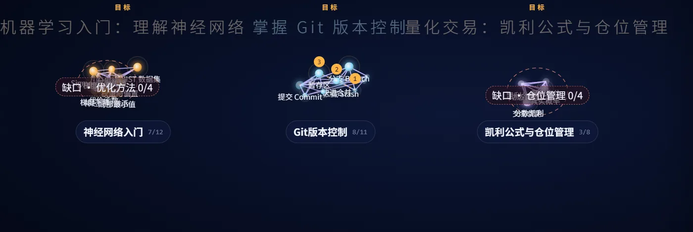
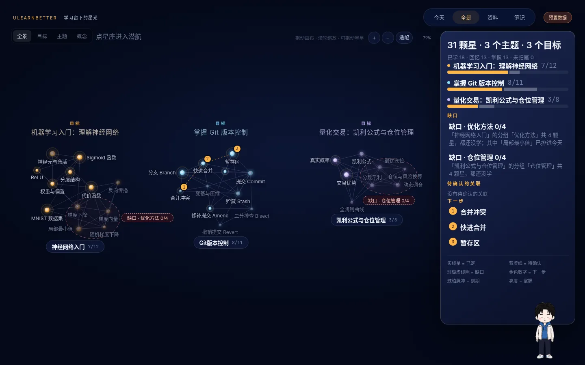

# 需求洞察与用户验证

## 1. 服务对象

**靠视频自学、同时推进多条学习线的大学生和自学者。**

典型的一天：白天上专业课，晚上在 B 站和 YouTube 上看 3Blue1Brown 学神经网络，周末研究量化交易的仓位管理，同时追 AI 前沿。每条线都有一堆视频、一堆笔记，没有老师排课，也没有考试逼着复习。

这不是想象出来的画像。项目负责人就是这样的学习者，同时推进**大学课业、量化交易、AI 前沿**三条学习线，手上有《双均线交易系统》《趋势交易全攻略》《AI 量化交易系统》等一批真实的视频学习笔记。

这些笔记本来就用 Obsidian 按「学习主页 / 课程笔记 / 概念卡 / 实操清单」的模板整理。UlearnBetter 的笔记编译器、六种知识形状和星图，都是照着这批真实材料长出来的（`docs/reference/GENERIC_TEMPLATE.md`、`tools/learning/`）。

## 2. 问题：不是记不下来，是学不进去

用一个真实场景说明：看完 3Blue1Brown 的神经网络三部曲（合计约 52 分钟），认真记了 12 章笔记、12 张概念卡。两周后：

1. **笔记还在，知识没了。** 只记得“好像有个梯度下降”。笔记是被动记录，离真正学会（主动加工、回忆、应用）还差很远。
2. **不知道今天该学什么。** 神经网络、Git、凯利公式三条线同时开着，打开笔记库，几十个文件，不知道该先复习哪个、往前学哪个。
3. **学到哪了说不清。** 哪些概念真懂了、哪些只是看过、哪一块完全没碰，没有任何地方能看出来。
4. **工具是割裂的。** 笔记在 Obsidian，闪卡要手工另做，进度只能记在脑子里，坚持成本很高。

### 我们的三个洞察

| 洞察 | 产品上的回应 |
| --- | --- |
| **整理不稀缺，学进去才稀缺。** 让模型总结、归类已经是通用能力，真正缺的是把整理好的内容变成“能学的东西” | 归类用现成方案，放在可替换的接口后面（`null / folder / llm` 三种整理器）；投入集中在星图、知识形状卡片和交互上 |
| **“今天该学什么”需要学习信号。** 只知道丢进来什么、打开过什么，算不出掌握程度 | 设计一个**最小但不为零**的学习动作：离开一颗星时点「记得 / 忘了」。成本只有一秒，却足以驱动掌握度、复习间隔和今日计划 |
| **智能体要可信，才能被长期使用。** 归错一次，用户就不敢再交给它 | 每个整理结果都附置信度和理由，可以撤销；用户修正存在独立的决定层，重新整理不会冲掉；今日计划的每一条理由都只由事实拼成 |

## 3. 用户验证与迭代

我们的验证方式很直接：**让目标用户（负责人）用原型和真实笔记试，拿到原话反馈，在同一天迭代。** 每一次反馈和对应的改动都能在仓库里查到。

### 迭代时间线

| # | 反馈来源与原话 | 我们的改动 | 证据 |
| --- | --- | --- | --- |
| 1 | **负责人，定位讨论**：「就是做一个学习记录整理 + 笔记学习新体验，自动归类不稀缺的话我们直接拿来用啊。」 | 定位从“全自动整理智能体”改为“学习记录整理 + 笔记学习新体验”。归类改为可替换组件，差异集中在学习体验 | `docs/reference/POSITIONING_v2.md`（v2 修订说明）；整理器接口 `server/src/record/organizers/`、`tools/learning/organizers.py` |
| 2 | **负责人，界面方向**：「现在主要的是做页面 UI 设计，我们现在只有一个页面。」偏好：极简、Agent 输入是唯一入口且固定在底部、不要以聊天框为中心的布局 | 做出可点击原型：三个视图（今天 · 全景 · 资料）加一根底部 Agent 栏，助手回答以卡片形式出现 | `docs/process/briefs/UI_TASK.md`；`docs/reference/ui-prototype-v2.html` |
| 3 | **负责人，看完 UI v1**：「不错的，但是没有个人学习统计，没有智能体整理学习资料，归类，给出个人学习全景图。」 | v2 补上三块且不增加页面：今天视图上的**学习统计层**、**资料视图**（把智能体的整理过程摊开）、**学习全景图**（目标 → 主题 → 概念，含缺口和下一步） | `docs/reference/UI_PLAN_v2.md`「v2 改了什么」；实现于 `6157c72`，集成于 `11af2dd` |
| 4 | **向负责人提出 5 个待拍板问题**：决定层存在哪、目标能否自动创建、是否接受最小学习动作等 | 第二轮计划据此写成 10 条产品裁决，例如“目标只能提议，用户确认后生效”“离星回忆是记得 / 忘了两键，可跳过” | `docs/development/SPRINT_02.md`「本轮产品裁决」 |
| 5 | **试用截图：全景图挤成一团**，目标标题连成一行、星星和标签互相压住 | 重写全景布局：每个目标独占一块，主题按星数分配椭圆星团，用力导向模拟摊开星星，标签做碰撞避让；画布支持拖动和缩放，星星可以拖。截图后不到一小时提交修复 | 见下方对比图；提交 `e39dbd6`；测试 `tests/ui-panorama-layout.test.mjs` |
| 6 | **外部试用者（朋友）从仓库拉起演示**：每个主题的笔记阅读器都显示「这个主题还没有笔记原文」 | 当天连续两次修复：演示笔记随主题一起打包，不再依赖特定的启动方式；后端版本过期时直接告诉用户该运行什么命令 | 提交 `344fc6f`、`0899676` |

### 迭代 5 前后对比

| 修复前（试用截图） | 修复后（当前版本） |
| --- | --- |
|  |  |

### 用真实材料验证，而不是只看效果图

- **真实视频跑通全链路**：6 个公开视频（3Blue1Brown、Fireship、Financial Wisdom）经过解析 → 模型生成笔记 → 编译 → 归类 → 学习记录。产出的 31 颗知识星、3 个目标提议和每条归类理由都保存在 `samples/demo/`，任何人都能拉起来亲自检查。
- **整理质量有评测集**：`samples/organize-eval/` 按负责人真实笔记里出现过的难例设计（合成数据，不含真实笔记），比如“AI 量化交易系统”应该同时属于量化和 AI 两个目标、和学习无关的资料应该进“未归属”、随手想法不应被拆成新概念，并配有准确率、查准、查全的打分工具（`tools/learning/organize_eval.py`）。
- **试用即回归**：每一次修复都配了测试。全景布局有专门的布局测试；笔记阅读器有路径安全和回退查找测试（`tests/server/topic-notes.test.mjs`）。
