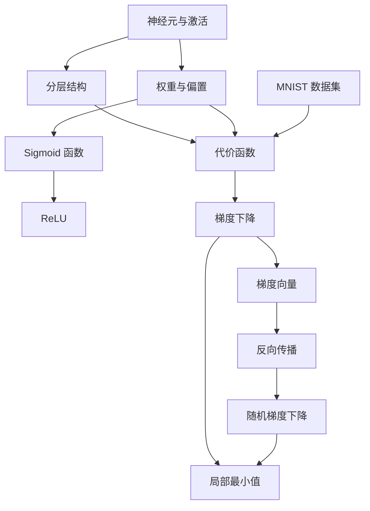

# 🏠 神经网络入门 · 学习主页

> [!info] 来源
> **《But what is a neural network? | Deep learning chapter 1》** — 3Blue1Brown · 18:40 · [视频链接](https://www.youtube.com/watch?v=aircAruvnKk) · 📄 [[视频信息 · But what is a neural network]]
> **《Gradient descent, how neural networks learn | Deep Learning Chapter 2》** — 3Blue1Brown · 20:33 · [视频链接](https://www.youtube.com/watch?v=IHZwWFHWa-w) · 📄 [[视频信息 · Gradient descent, how neural networks le]]
> **《Backpropagation, intuitively | Deep Learning Chapter 3》** — 3Blue1Brown · 12:47 · [视频链接](https://www.youtube.com/watch?v=Ilg3gGewQ5U) · 📄 [[视频信息 · Backpropagation, intuitively]]

> [!abstract] 一句话总结
> 跟随 3Blue1Brown 深度学习三部曲，从神经元与分层结构，到代价函数、梯度下降与反向传播，看懂神经网络如何“学会”识别手写数字。

## 🗺️ 全景图

## 📚 学习路线

### 第一阶段 · 看懂结构
- [ ] [[ch01 认识神经元]]
- [ ] [[ch02 分层结构]]
- [ ] [[ch03 边缘检测的期望]]
- [ ] [[ch04 权重偏置与学习]]
- [ ] [[ch05 记号与线性代数]]
- [ ] [[ch06 结语与激活函数]]

### 第二阶段 · 理解学习
- [ ] [[ch07 训练数据入门]]
- [ ] [[ch08 代价函数]]
- [ ] [[ch09 梯度下降]]
- [ ] [[ch10 网络实际学到了什么]]

### 第三阶段 · 深入机制
- [ ] [[ch11 反向传播直觉]]
- [ ] [[ch12 随机梯度下降]]

## 🧩 核心概念卡

| 主题 | 概念卡 |
| --- | --- |
| 网络结构 | [[神经元与激活]] · [[分层结构]] · [[权重与偏置]] · [[Sigmoid 函数]] · [[ReLU]] |
| 学习机制 | [[代价函数]] · [[反向传播]] |
| 优化方法 | [[梯度下降]] · [[梯度向量]] · [[随机梯度下降]] · [[局部最小值]] |
| 训练实践 | [[MNIST 数据集]] |

## 🛠️ 实操清单
- [[手算一个神经元的前向传播]] · [[清点网络参数并做结构实验]]

## 📖 查阅
[[视频信息 · But what is a neural network]] · [[视频信息 · Gradient descent, how neural networks le]] · [[视频信息 · Backpropagation, intuitively]] · [[术语表]]

> [!quote] 金句
> ==我们说神经网络在“学习”，其实就是它在最小化一个代价函数。——《Gradient descent, how neural networks learn》（约 9:45 处）==
