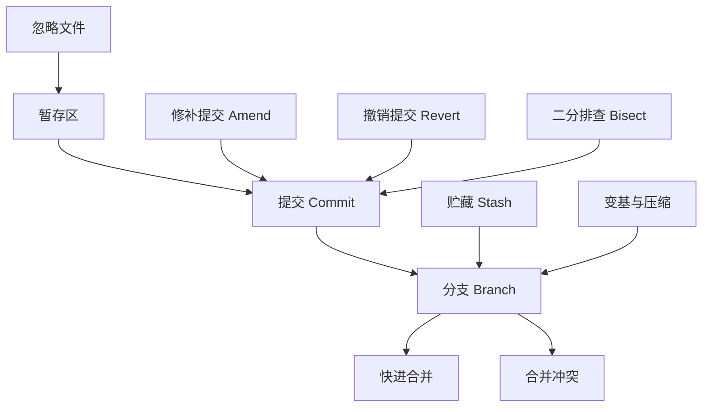

# 🏠 Git 版本控制 · 学习主页

> [!info] 来源
> **《Git It? How to use Git and Github》** — Fireship · 12:19 · [视频链接](https://www.youtube.com/watch?v=HkdAHXoRtos)
> **《13 Advanced (but useful) Git Techniques and Shortcuts》** — Fireship · 8:06 · [视频链接](https://www.youtube.com/watch?v=ecK3EnyGD8o)
> 📄 [[视频信息 · Git It How to use Git and Github]] · [[视频信息 · 13 Advanced (but useful) Git Techniques]]

> [!abstract] 一句话总结
> 两个 Fireship 视频串起 Git 从初始化、暂存提交、分支合并到 GitHub 开源协作的完整流程，并补充 13 个进阶提效技巧。

## 🗺️ 全景图

## 📚 学习路线

### 第一阶段 · Git 基础与本地工作流
- [ ] [[ch01 认识 Git 与初始化仓库]]
- [ ] [[ch02 忽略文件、暂存与提交]]
- [ ] [[ch03 分支与快进合并]]

### 第二阶段 · 合并协作与远程开源
- [ ] [[ch04 Stash 与合并策略]]
- [ ] [[ch05 推送 GitHub 与开源协作]]

### 第三阶段 · 进阶技巧与效率提升
- [ ] [[ch06 快速提交与命令别名]]
- [ ] [[ch07 修补与撤销提交]]
- [ ] [[ch08 云端开发与 Stash 进阶]]
- [ ] [[ch09 日志美化与历史排查]]
- [ ] [[ch10 钩子、清理与快速切换]]

## 🧩 核心概念卡

| 主题 | 概念卡 |
| --- | --- |
| 核心机制 | [[提交 Commit]] · [[暂存区]] · [[忽略文件]] |
| 分支与合并 | [[分支 Branch]] · [[快进合并]] · [[合并冲突]] · [[变基与压缩]] |
| 工作流提效 | [[贮藏 Stash]] · [[二分排查 Bisect]] |
| 撤销与修复 | [[修补提交 Amend]] · [[撤销提交 Revert]] |

## 🛠️ 实操清单
- [[新仓库上手清单]] · [[Git 提效与自救清单]]

## 📖 查阅
[[视频信息 · Git It How to use Git and Github]] · [[视频信息 · 13 Advanced (but useful) Git Techniques]] · [[术语表]]

> [!quote] 金句
> ==把 Git 用好——这是我听过最好的建议之一；对软件工程师来说，几乎没有比把 Git 搞砸更可怕的事了。==
