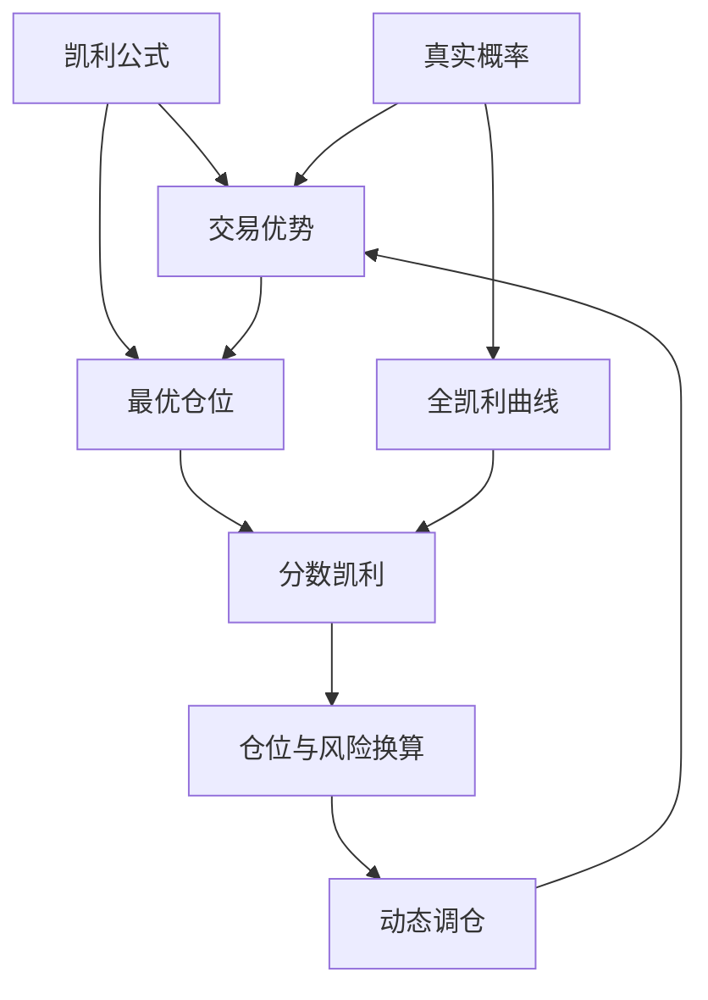

# 🏠 凯利公式与仓位管理 · 学习主页

> [!info] 来源
> **《KELLY CRITERION | Ed Thorp | Optimal Position Sizing For Stock Trading》** — Financial Wisdom · 8:13 · [视频链接](https://www.youtube.com/watch?v=THYLv5_0Vm8) · 📄 [[视频信息 · KELLY CRITERION]]

> [!abstract] 一句话总结
> 用凯利公式把胜率与盈亏比换算成最优仓位，再用分数凯利在充满随机性的股市里控制风险、随表现动态调仓。

## 🗺️ 全景图

## 📚 学习路线

### 第一阶段 · 理解公式
- [ ] [[ch01 引言与凯利公式原理]]
- [ ] [[ch02 凯利公式手算实例]]

### 第二阶段 · 实战调仓
- [ ] [[ch03 分数凯利与动态调仓]]
- [ ] [[ch04 全凯利曲线与适用边界]]

## 🧩 核心概念卡

| 主题 | 概念卡 |
| --- | --- |
| 公式与原理 | [[凯利公式]] · [[交易优势]] · [[真实概率]] |
| 仓位管理 | [[最优仓位]] · [[分数凯利]] · [[仓位与风险换算]] · [[动态调仓]] |
| 收益与波动 | [[全凯利曲线]] |

## 🛠️ 实操清单
- [[凯利仓位计算清单]] · [[交易表现记录与调仓清单]]

## 📖 查阅
[[视频信息 · KELLY CRITERION]] · [[术语表]]

> [!quote] 金句
> ==「仓位大小不应是策略的预设输入，而应是依据本金、盈亏比与胜率四个变量计算出的输出」==
