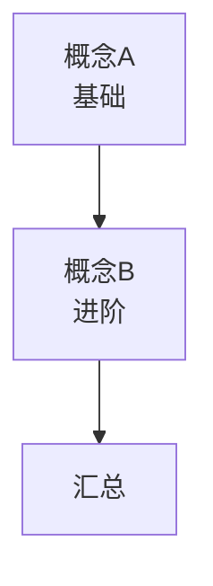

# 🏠 演示主题 · 学习主页

> [!info] 来源
> **《演示视频一（虚构）》** — 演示作者 · 10:30 · [视频链接](https://www.youtube.com/watch?v=demo000001) · 📄 [[演示主题 · 视频信息与时间戳]]

## 🗺️ 全景图

## 📚 学习路线

### 第一阶段 · 基础

- [ ] [[ch01 概念A]] — 开场与要点

### 第二阶段 · 进阶

- [ ] [[ch02 双线对比]] — 对比与流程

## 🧩 核心概念卡

| 主题 | 概念卡 |
| --- | --- |
| 基础 | [[概念A]] |
| 进阶 | [[概念B]] |

## 🛠️ 实操清单

- [[环境搭建清单]]
